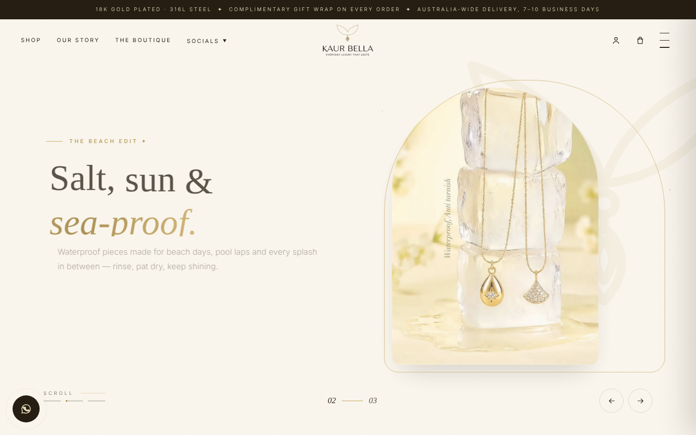
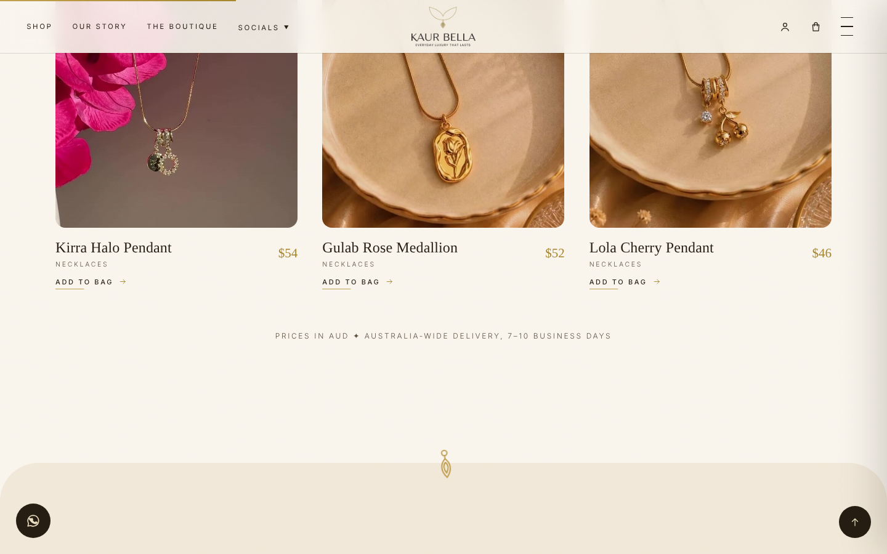
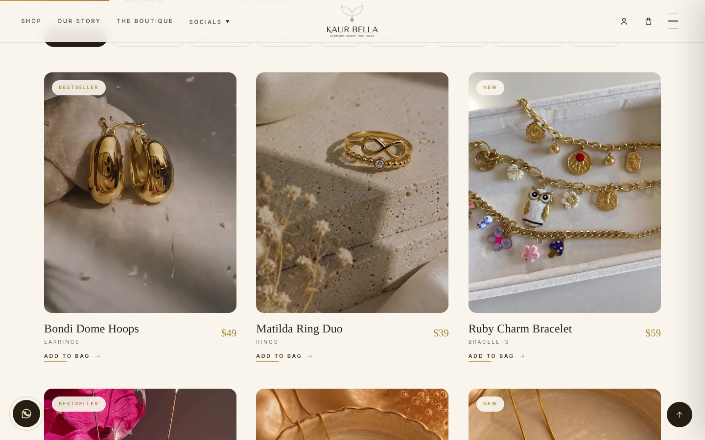
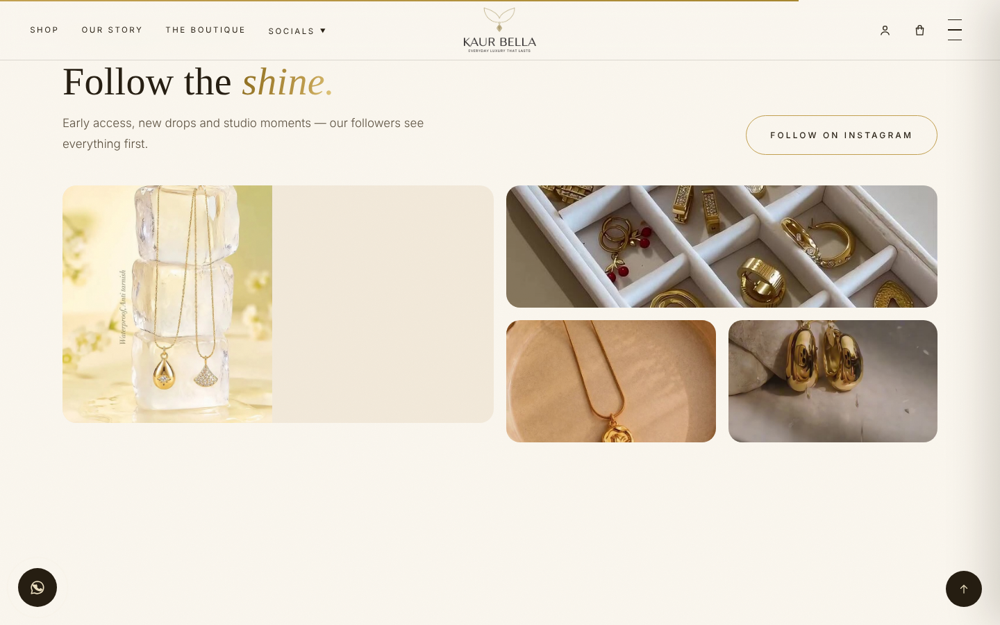
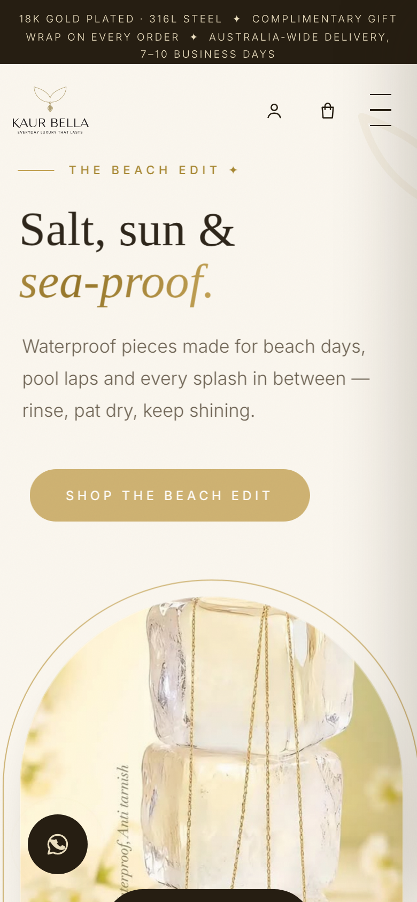

# Kaur Bella — Demi-Fine Jewellery Storefront

> A custom-built, responsive e-commerce storefront for an Australian demi-fine jewellery brand — designed and developed solo, from a Shopify brief to a hand-coded production build.

**Role:** Sole designer & developer &nbsp;·&nbsp; **Type:** Freelance client project &nbsp;·&nbsp; **Status:** In final review, pending client deployment

---

## Overview

Kaur Bella is a demi-fine jewellery brand (18k gold-plated 316L stainless steel — waterproof, hypoallergenic and anti-tarnish). The client originally scoped a Shopify store; I proposed and built a bespoke, self-contained storefront instead — faster, lighter, cheaper to run, and fully under the brand's control, with no platform lock-in or per-sale fees.

I was the only person on the project: design, front-end development, content structure, SEO, performance and the asset pipeline.

> **Note on the source code:** This is a showcase repository. The full source is kept private while the client's site is pre-launch — happy to walk through the code or share samples on request.

## Screenshots

### Homepage

### Product catalogue

### Collection

### Social proof

### Mobile

## What it does

- **Full storefront experience** — hero, curated collections, a shoppable product grid, add-to-bag flow, brand story, reviews and footer, in one fast-loading page.
- **Responsive, mobile-first** — fluid layouts and touch-friendly navigation from 320px up to widescreen.
- **E-commerce UX** — product cards, a slide-in bag and a checkout-ready structure.
- **SEO-ready** — semantic HTML and JSON-LD structured data for products and the organisation.
- **Security-conscious** — self-contained build with no third-party trackers or unnecessary external calls.
- **Performance** — pipeline-processed, optimised imagery and minimal dependencies.

## Built with

- **HTML5, CSS3 and vanilla JavaScript** — no framework; hand-written and dependency-light
- **Inline SVG** for crisp icons and brand marks
- **JSON-LD** for structured data / SEO
- **ffmpeg & ImageMagick** asset pipeline for responsive, optimised media
- **Netlify** for hosting and deployment
- AI-assisted development (Claude Code / Cursor) for faster iteration

## Approach

Briefed for Shopify, I proposed a custom build to give the brand a lighter store with no platform fees or lock-in — while keeping the polish and conversion focus of a commercial storefront. The result is a single, self-contained page that loads quickly, can be hosted anywhere, and is fully owned by the client.

---

**Shravan Suresh Kumar** &nbsp;·&nbsp; [LinkedIn](https://www.linkedin.com/in/shravan-s-kumar/) &nbsp;·&nbsp; shravan.myworkspace@gmail.com
